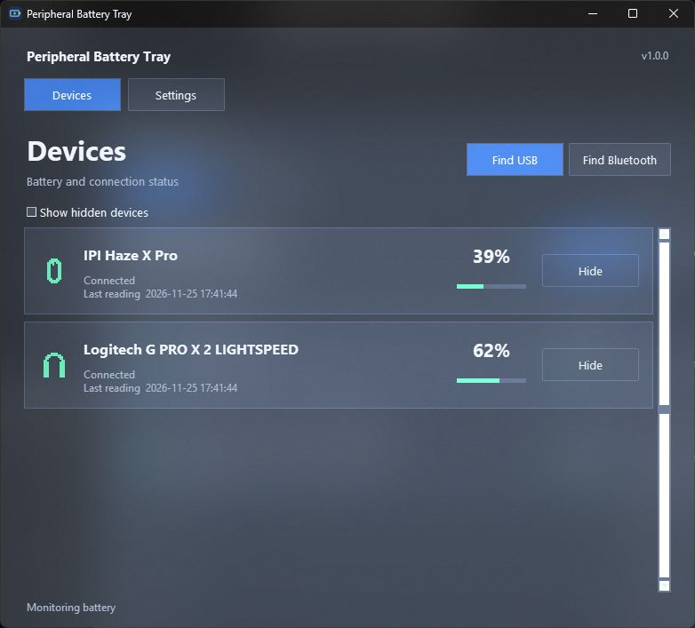

# Peripheral Battery Tray

See the battery percentage of your **IPI Haze X Pro** mouse or **Logitech G PRO X 2 LIGHTSPEED** headset next to the Windows clock. Use the original wireless USB receiver, choose a separate tray icon for each device, and set a low-battery alert. Battery readings stay on your PC.

[Download portable ZIP](https://github.com/Bratuha1/peripheral-battery-tray/releases/download/v1.0.0/PeripheralBatteryTray-1.0.0-windows-x64-portable.zip) · [All release files](https://github.com/Bratuha1/peripheral-battery-tray/releases/latest) · [Русская инструкция](docs/ru.md)

**Windows 10 and 11, 64-bit.** Extract the ZIP, run `PeripheralBatteryTray.exe`, plug in your receiver and click **Find USB**. Use **Find Bluetooth** for devices with a readable Bluetooth LE Battery Service.



## Install or run without installing

The [v1.0.0 release](https://github.com/Bratuha1/peripheral-battery-tray/releases/tag/v1.0.0) includes Python and its libraries. It offers an installer, a portable ZIP and a standalone EXE.

- **Installer**. Run the file ending in `-setup.exe`. It installs for your Windows user and adds a Start menu shortcut.
- **Portable**. Extract the ZIP to a folder you intend to keep, then run `PeripheralBatteryTray.exe`.

Exit any older source or tray build before launching v1.0.0. The initial builds are unsigned. Check the archive against `SHA256SUMS.txt` before running it if Windows shows a reputation warning.

## Daily use

1. Connect the original USB receiver or wake your Bluetooth LE peripheral. Use **Find USB** for compatible USB receivers, or **Find Bluetooth** for Bluetooth LE. USB discovery works without a Bluetooth adapter.
2. The **Devices** page shows the latest exact percentage, connection or reading status, and the time of the last good reading. A dash indicates no current reading. Use **Hide** to remove a device from the list and tray. **Show hidden devices** lets you restore it.
3. Click a tray icon to open the window. Right-click for refresh, discovery or exit. Closing the window leaves the app in the tray.
4. In **Settings**, choose the icon mode, percentage badges, refresh interval (5–3600 seconds), themes, language and Windows sign-in behavior. Separate mode shows each device, with a choice of device silhouettes or battery indicators. New installations enable per-user startup and launch in the tray at sign-in. In single-icon mode a percentage badge shows the lowest available reading. Hover for the device names and readings that fit in the Windows tooltip.
5. Set the low-charge thresholds for mice, headsets and other devices. A threshold of zero disables alerts for that group. An alert fires once per low-charge episode in a running session and rearms after the reading rises three points above the threshold, up to 100%.

Windows manages which icons appear next to the clock and which are under **^**. Drag the icons beside the clock, or open the official Windows settings via **Pin tray icons in Windows** in the app. The app uses stable icon identities for a fixed executable path. Windows can treat a moved executable as a new app, and controls icon ordering.

## Compatibility

| Device or protocol | Connection | Evidence |
| --- | --- | --- |
| IPI Haze X Pro | Original 2.4 GHz USB receiver, `372E:10F9` | Battery reading verified with v1.0.0 on Windows 11. |
| Logitech G PRO X 2 LIGHTSPEED | Original LIGHTSPEED USB receiver, `046D:0AF7` | Battery reading verified with v1.0.0 on Windows 11. |
| Standard Bluetooth LE Battery Service | Readable `180F` / `2A19` on an advertising BLE device | Standard reader. Availability depends on the device, Windows pairing and address stability. |
| Logitech HID++ 2.0 with Unified Battery | Selected Bolt, Unifying or LIGHTSPEED USB receivers | Experimental. Devices appear after returning a valid exact percentage. Hardware verification pending. |
| Other proprietary USB devices | Model-specific USB protocols | See the [device guide](docs/adding-devices.md). |

Automatic BLE discovery looks for advertisements containing the Battery Service and saves a device only after reading a valid Battery Level. Devices that expose the service without advertising it can be configured in `%APPDATA%\PeripheralBatteryTray\devices.toml`. See the [device guide](docs/adding-devices.md). Bluetooth Classic, proprietary services and separate earbud and case readings need their own implementation.

**Tried your device?** [Share a compatibility result or request a model](https://github.com/Bratuha1/peripheral-battery-tray/issues/new?template=device-compatibility.yml). Include the exact model and connection type so other owners can tell whether the result applies to them.

## Troubleshooting

- **No fresh reading**. Wake the peripheral and check the receiver or Windows Bluetooth settings. Select **Refresh battery** from the icon menu. Some devices stop advertising while asleep or while connected to another host.
- **No icons next to the clock**. Look under **^** or check Windows taskbar settings.
- **No alerts**. Check the applicable threshold and Windows notification or Do Not Disturb settings.
- **Portable EXE moved**. Re-enable **Start with Windows** in settings to register the new path.

Settings, manually configured BLE devices and rotating logs are under `%APPDATA%\PeripheralBatteryTray`. The installer preserves them during uninstall. The portable build uses the same location. Remove personal identifiers before sharing diagnostics in an [issue](https://github.com/Bratuha1/peripheral-battery-tray/issues/new).

## Develop and build

Use 64-bit CPython 3.13 on Windows.

```powershell
py -3.13 -m venv .venv
.\.venv\Scripts\python.exe -m pip install -r requirements-build.txt
.\.venv\Scripts\python.exe -m unittest discover -s tests -v
.\.venv\Scripts\python.exe peripheral_battery.py
.\.venv\Scripts\python.exe scripts/build.py
.\.venv\Scripts\python.exe scripts/smoke_exe.py dist/PeripheralBatteryTray.exe --lifecycle
```

Pass `--iscc "C:\path\to\ISCC.exe"` to `scripts/build.py` to build the per-user installer with Inno Setup 6.7 or later. Outputs are under `dist`. On a matching version tag GitHub Actions tests and builds the project and prepares a **draft** GitHub release. Complete the [hardware checklist](docs/release-checklist.md) before publishing. See the [release runbook](docs/publishing.md) for tag, artifact and publication steps.

[Changelog](CHANGELOG.md) · [MIT License](LICENSE)
